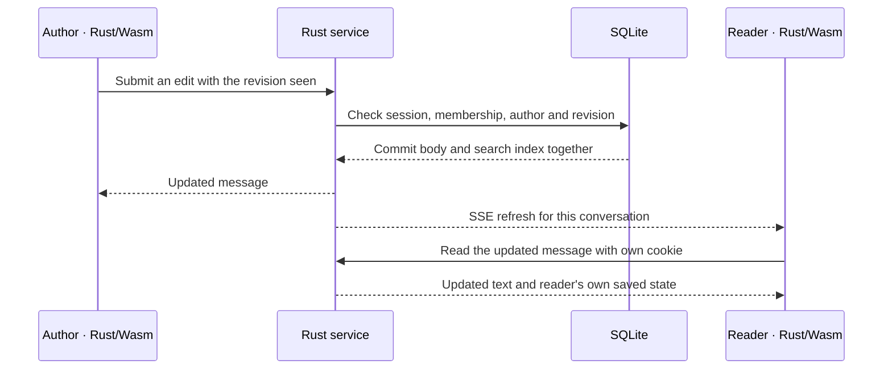

# Rill Chat software design document (SDD)

## User experience

| Layer | Decision |
| --- | --- |
| Strategy | Make the next message and its destination immediately apparent. |
| Scope | Channel chat, DMs, thread replies, a small reaction palette, search and invite-only workspace membership. |
| Structure | The sidebar picks a conversation. The timeline stays in the center. A contextual side panel displays details or the selected thread. |
| Skeleton | Keep the composer visible. Preserve a draft per conversation. On phones, open navigation and threads on demand to give the timeline the full screen. |
| Surface | Use light gray navigation and a softly lit neutral conversation area. Reserve muted indigo for selection, links and primary actions. A dim charcoal theme is available for lower ambient light. Names and text accompany color. Fictional preview data stays in the browser. |

The preview can be explored without signing up. All writes require a real account. A real workspace starts with empty channels; no example messages are copied into storage.

## Runtime

One Rust binary embeds the frontend assets. Axum/Tokio handles HTTP and Server-Sent Events (SSE). SQLite uses WAL, bounded history windows, conversation indexes and serialized writes. Event delivery occurs after commit. The initial SSE handshake and reconnects refresh authoritative state. Readers may fetch older messages using a cursor.

SQLite and one application instance are a deliberate fit for a self-hosted small team. The service stores password hashes and hashes of opaque session and invitation tokens. It checks workspace and conversation access on every operation and before sending events. Only the two participants can access a DM, including through search and streaming. The production profile requires secure cookies. Keep chats, accounts and invite codes out of public artifacts.

## Delivery

Feature changes go through pull requests into develop. A release pull request promotes develop to main. A semantic version identifies the exact main revision. Publish an immutable OCI image and deploy that digest to a separately configured production environment. Development and production use independent databases. See CONTRIBUTING.md and the operations guide for the actual commands.

## Reading comfort

Someone following a long thread should be able to read the author and body, recognize the active channel and find Send without scanning a saturated sidebar. This leads to three decisions: neutral surfaces, one accent for actions, and a saved appearance choice that also supports the device preference. Keep the conversation layout, content, composer behavior and the original channel illustration. Verify both palettes on real screens and check computed contrast for normal text, focus and meaningful controls.

The MCP development file has its own directory and uses the production schema. Keep the single-instance SQLite/SSE design for this release. Multiple active Rust instances would need a shared event source and durable catch-up in addition to remote storage. [Infrastructure choices](../../../docs/infrastructure.md)

## A Rust browser client and the work after posting

A member can correct a typo without losing its thread, or keep a private reading list. A member who changes passwords keeps working on the current device while other devices sign out. For these stories the strategy is to preserve the flow of conversation. The scope adds edits, saved items and password changes. Message actions and the account menu are the entry points. Editors and saved results return to the original conversation. Keep the existing light/dim surfaces and accessible Japanese labels for both pointer and keyboard.

Compile the browser client from Rust to WebAssembly. Use the browser's native DOM, Fetch, EventSource, storage and media queries through platform bindings. A small Rust appearance module runs from the initial script before CSS paints, so a returning reader sees the stored palette while the main module downloads. The server embeds the assets and serves WebAssembly with its registered MIME type. SQLite stays on the server. Keep v0.2's HTTP protocol, bounded history and commit-before-broadcast ordering. Authenticated requests and event recipients use server-side membership.

Schema v2 adds an edit timestamp, a private save relation and search maintenance for edits. Compare the editor's last-seen version transactionally. Keep send retry identity valid after an edit. Saved lists are per viewer, paginated by descending message ID. Editing emits an audience-scoped refresh. A save refresh reaches only that member. Password rotation verifies the current hash, updates it and replaces sessions atomically, then revalidates active streams. [Authentication design](../../../docs/authentication.md) · [OSS principles](../../../docs/design-principles.md)

