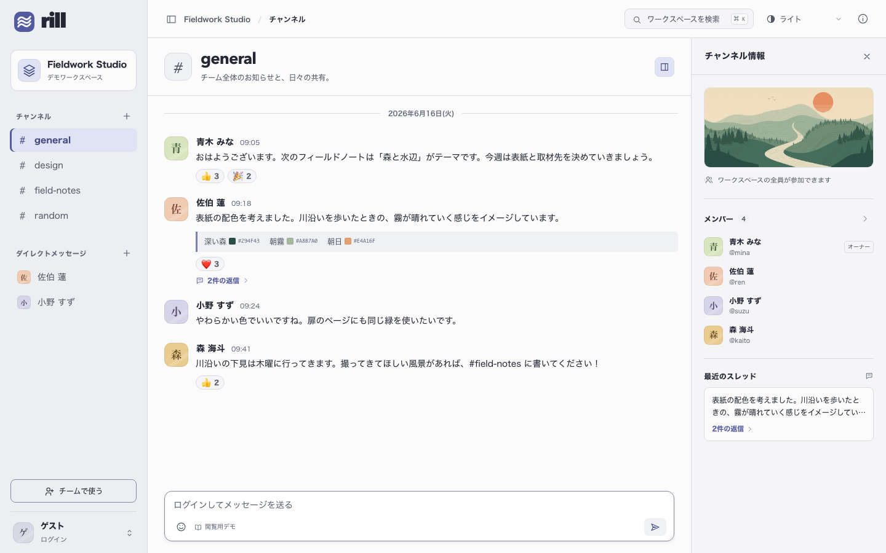

# Rill Chat

Rill is a self-hosted team chat built in Rust. Create a private workspace, invite a teammate and talk in channels, direct messages or threads. The Japanese web client ships inside the server binary.

<picture>
  <source media="(prefers-color-scheme: dark)" srcset="docs/preview-dim.png">
  
</picture>

## Start chatting

On Linux, download the archive for your CPU from [Releases](https://github.com/haranishi/rill-chat/releases), check its SHA-256 against `SHA256SUMS`, extract it and run `./rill-chat` inside the extracted directory. The binaries target Debian 12 or a compatible glibc system.

To build from source with stable Rust, clone the repository and run the server.

```sh
git clone https://github.com/haranishi/rill-chat.git
cd rill-chat
cargo run --release --locked
```

Open [Rill on localhost](http://127.0.0.1:3847). The first screen lets you explore a read-only sample. Choose **チームで使う** to create a workspace. On a phone, open the menu to find this button. Existing members can sign in with **ログイン**.

Choose **メンバーを招待** to generate a 24-hour invitation code. A teammate opens the same server address, chooses **招待で参加**, and registers with that code. For a local trial, open a private browsing window as the second person. For access from other devices, run the server behind HTTPS as described in the [operations guide](docs/deployment.md).

You can also start the development server with Docker Compose.

```sh
docker compose up --build
```

## What the team can do

- Create channels, reply in threads, add reactions and chat privately with another member.
- Search accessible messages, including Japanese text, and jump to the matching conversation.
- Get new messages as soon as they are committed. Reconnecting reloads stored history, and retrying a send safely reuses its message identifier.
- Use the appearance control in the top bar to choose **ライト**, **ダーク** or the device setting. The browser remembers the choice across visits.

The service uses Axum, Tokio and SQLite in WAL mode. Each account belongs to one workspace. Anyone with access to the service can create a separate workspace. The workspace owner issues invitations to join their team. The sample conversations stay in the browser.

## Performance and operations

The delivery benchmark starts an isolated server and measures from the start of a sender’s HTTP request until a second signed-in connection decodes the matching SSE event. The browser suite also measures from Enter in one Chromium session to the message appearing in another session’s DOM.

```sh
cargo build --release --locked
node tests/bench.mjs target/release/rill-chat 200
node tests/fanout.mjs target/release/rill-chat
```

In a macOS arm64 loopback run of v0.2.0 with a warm release build, 200 sequential messages reached the receiving SSE client in 0.35 ms at p50 and 0.56 ms at p95. In Chromium 159, 24 Enter-to-DOM samples measured 2.0 ms at p50 and 2.5 ms at p95. With four concurrent senders and sixteen subscribers, all 3,200 deliveries arrived. The p95 time for a post to reach its last subscriber was 1.51 ms. Network distance and hardware affect deployment results.

Deploy one application instance per SQLite database. Development Compose and production use separate volumes. The production workflow verifies a versioned image digest before the host starts it. [Infrastructure choices](docs/infrastructure.md) · [Connect a local development database over MCP](docs/local-database-mcp.md) · [Deployment and recovery](docs/deployment.md)

## Contribute and license

Open feature pull requests against `develop`. A release pull request promotes a tested change to `main`. See [Contributing](CONTRIBUTING.md) for the test commands and release procedure.

Rill’s original code and artwork are available under the [MIT License](LICENSE).
